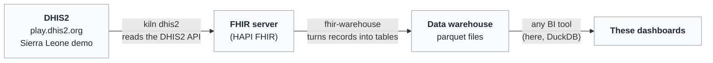
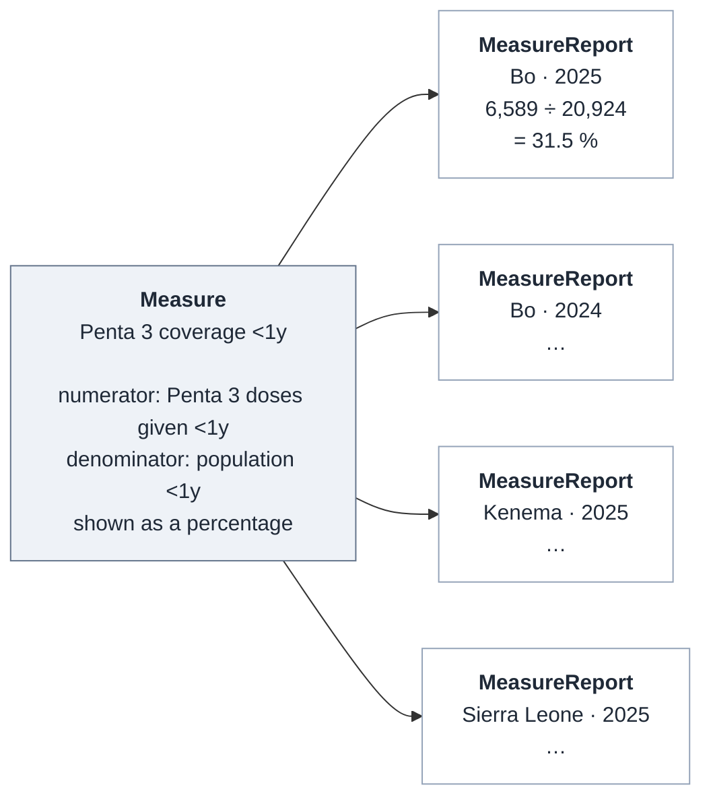
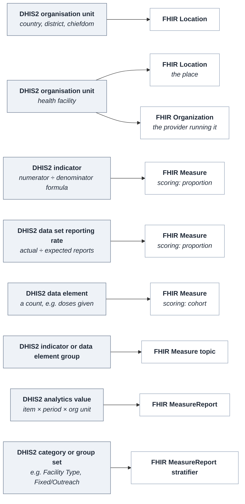
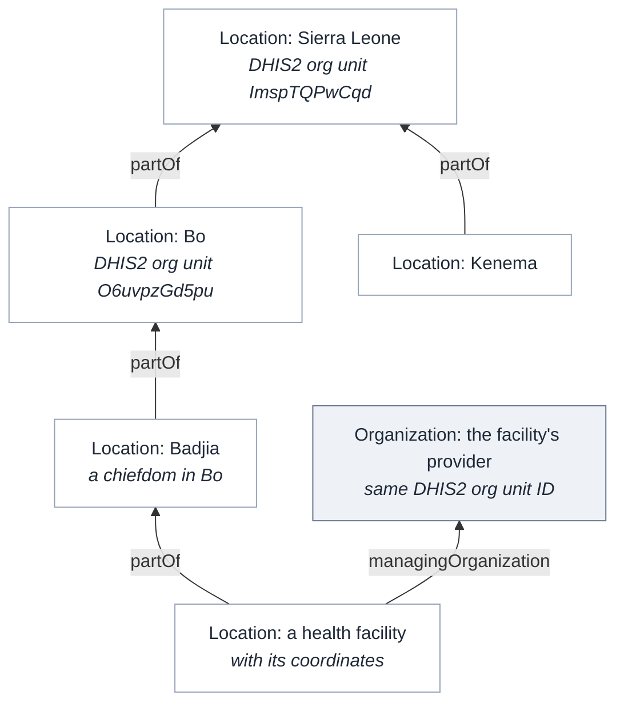

# How DHIS2 data becomes FHIR

These dashboards show the Sierra Leone figures from the DHIS2 demo server (play.dhis2.org).
The figures do not come from DHIS2 directly. They were copied into a FHIR server, which
stores health data in a standard format called FHIR, and every chart here is drawn from
that FHIR copy. The point is to show that DHIS2's data, and dashboards
built on it, can be carried over into FHIR without losing anything.

This page explains how that works, starting with the parts of FHIR the dashboards rely on.

## The data passes through four steps



1. **kiln dhis2** asks DHIS2 for its places, its indicator definitions and its indicator
   values, and writes each as a FHIR record.
2. Those records are loaded into a **FHIR server**, where any FHIR tool can read them.
3. **fhir-warehouse** downloads them again and flattens them into tables, one row per value.
4. The **dashboards** are built from those tables. Here they use DuckDB to draw the same
   charts the DHIS2 dashboards draw.

## FHIR in brief

FHIR (Fast Healthcare Interoperability Resources) is a standard for exchanging health data.
It describes each kind of thing as a **resource**: a record with a fixed set of fields that
every FHIR system understands. There are resources for patients, vaccinations, health
facilities, and so on. These dashboards need only four:

| Resource | What it holds | Example |
|---|---|---|
| `Location` | A place: the country, a district, a chiefdom or a health facility | Bo district |
| `Organization` | The organisation that runs a health facility, as distinct from the building and where it is | the provider at a clinic |
| `Measure` | The definition of an indicator: what is counted and how the figure is worked out | Penta 3 coverage under one year |
| `MeasureReport` | One result of that indicator, for one place and one period | Penta 3 coverage in Bo in 2025: 31.5 % |

Resources point to each other by reference. A MeasureReport names the Measure it is a
result of and the Location it is about, much as a row in a spreadsheet might name a column
heading and a district.

## Measures and MeasureReports

A **Measure** is the definition of an indicator. A **MeasureReport** is the value of that
indicator for one place and one period.

The Measure says what is counted and how the counts are combined. It holds no numbers.
"Penta 3 coverage" is a Measure: the number of children under one who received their third
pentavalent dose (the **numerator**), divided by the number of children under one (the
**denominator**), shown as a percentage.

A MeasureReport records the result for one place and one period: the numerator, the
denominator and the score worked out from them. It names the Measure it reports on, the
place and the period. Each district has its own MeasureReport for each year, quarter and
month, so one Measure has many MeasureReports.

In this case DHIS2 calculated every value, and each MeasureReport is a copy of one DHIS2
result. In other settings the MeasureReports are generated from individual records, such
as vaccinations, by software that evaluates the Measure's definition.



Some Measures have no division. "Penta 3 doses given" is simply a count, so its Measure has
one population and its MeasureReports carry one number each. FHIR calls these Measures
**cohort** Measures; the ones with a numerator and a denominator are **proportion** Measures.

A MeasureReport can also break its result down. The national measles figure for November
2025, for example, carries one line per facility type (CHC, clinic, hospital, MCHP and so
on), each with its own numerator and denominator. FHIR calls the breakdown a
**stratifier** and each line a **stratum**.

## How the DHIS2 model maps to FHIR

DHIS2 and FHIR describe the same things in different words. The mapping is close to
one-to-one.



### Organisation units become Locations, and facilities also become Organizations

Every DHIS2 organisation unit becomes a FHIR `Location`: the country, 13 districts, 152
chiefdoms and 1,166 facilities. DHIS2's parent-child hierarchy becomes the Location's
`partOf` field, which points to the place one level up. Boundaries and facility
coordinates come across too, which is what the maps on these dashboards use.

DHIS2 uses one organisation unit for a health facility. FHIR splits it in two: a
`Location` for the place (its name, coordinates and position in the hierarchy) and an
`Organization` for the health provider that runs it. Each of the 1,166 facilities gets
both, with the same DHIS2 identifier, and the Location points to its Organization through
its `managingOrganization` field. Districts and chiefdoms are only places, so they get a
Location alone.



Each Location and Organization keeps its DHIS2 identifier, so any FHIR record can be
traced back to the DHIS2 organisation unit it came from, and later imports find the same
place again.

### Indicators, data elements and reporting rates become Measures

| DHIS2 | FHIR Measure |
|---|---|
| Indicator ID and code | `identifier` |
| Name and description | `title`, `description` |
| Numerator and denominator formulas | `group.population`: a numerator and a denominator, each with its DHIS2 formula |
| Indicator type (per cent, per 1,000, number) | `scoring`, and the factor (100 for a percentage) |
| Data element (a plain count) | a `cohort` Measure with one population |
| Data set reporting rate | a `proportion` Measure: actual reports ÷ expected reports |
| Indicator group, data element group | `topic` (Immunization, ANC, Delivery …) |

The Sierra Leone import holds 199 Measures: 39 indicators, 154 data elements and 6
reporting rates, covering every item on the 14 dashboards.

### Indicator values become MeasureReports

DHIS2 serves each value through its analytics API as a row with three coordinates: which
item (`dx`), which period (`pe`) and which organisation unit (`ou`). Each row becomes one
MeasureReport.

| DHIS2 analytics row | FHIR MeasureReport |
|---|---|
| `dx` (the indicator) | `measure`: the Measure above |
| `ou` (the org unit) | `subject`: the Location with that DHIS2 identifier |
| `pe` (e.g. `2025`, `2025Q1`, `202511`) | `period`: start and end dates |
| numerator, denominator | `group.population` counts |
| value | `group.measureScore` |
| breakdown by a category or group set | `group.stratifier` |

Here is the same figure in both systems:

<div class="grid grid-cols-2">
<div class="card">

**DHIS2 analytics row**

```text
dx          tUIlpyeeX9N   Penta 3 Coverage <1y
pe          2025
ou          O6uvpzGd5pu   Bo
numerator   6589
denominator 20924
value       31.49
```

</div>
<div class="card">

**FHIR MeasureReport** (shortened)

```json
{
  "resourceType": "MeasureReport",
  "status": "complete",
  "type": "summary",
  "measure": "…/Measure/sl-demo-tUIlpyeeX9N",
  "subject": {"reference": "Location/sle-O6uvpzGd5pu",
              "display": "Bo"},
  "period": {"start": "2025-01-01", "end": "2025-12-31"},
  "group": [{
    "population": [
      {"code": "numerator",   "count": 6589},
      {"code": "denominator", "count": 20924}],
    "measureScore": {"value": 0.3149}
  }]
}
```

</div>
</div>

FHIR stores the score as a fraction (0.3149) rather than a percentage. The Measure records
DHIS2's factor (100), and the dashboards multiply by it to show 31.5 %.

The import holds 161,216 MeasureReports: the country, districts and chiefdoms for every
year from 2016 to 2026, quarters and months for 2025 and 2026, and facilities for 2025
and 2026.

## From FHIR records to charts

Charts need tables, not individual records. fhir-warehouse reads every Measure and
MeasureReport and flattens them with **ViewDefinitions**, FHIR's standard way of saying
"make a table with these columns from these fields". One MeasureReport becomes one row:

| measure | location | period | numerator | denominator | score |
|---|---|---|---|---|---|
| Penta 3 Coverage <1y | Bo | 2025 | 6,589 | 20,924 | 0.3149 |

The tables are saved as parquet files, a common format for data tables. Once the data is
in parquet, a wide range of BI and analysis tools can read it and build dashboards on it.
These dashboards use DuckDB.

## Things to know

- **The values are DHIS2's own.** DHIS2 works out each indicator for each place and period
  itself, and the import copies the result. The dashboards never add up or average
  indicator values across places or periods, because that would give a different answer
  from DHIS2's.
- **A missing value means no record.** Where DHIS2 has no value, there is no MeasureReport,
  and the charts show a gap rather than a zero.
- **The data is DHIS2's training data.** The Sierra Leone demo is generated for training;
  the figures are not real Sierra Leone statistics.
- **Facility-level values cover 2025 and 2026 only.** Earlier years were imported for the
  country, districts and chiefdoms.
- **The same Measures work beyond DHIS2.** Figures from other sources, such as campaign
  results or surveys, can be stored as the same Measure and MeasureReport resources, so
  DHIS2 routine data and other data can sit side by side and be read by the same tools.
