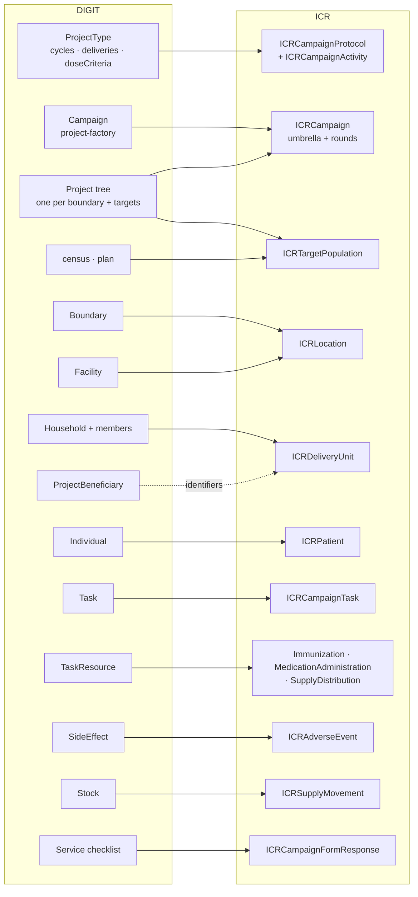

# DIGIT HCM and the ICR — data model comparison and mapping to FHIR

<sub>`v0.1.0 · Last modified Oct 26, 2026 at 12:48 PM EDT`</sub>

DIGIT Health Campaign Management (HCM) is eGov Foundation's open-source campaign system:
Java/Spring microservices on the DIGIT platform, a Flutter field app that works offline,
a web console for campaign setup, and a microplanning module. It covers the same ground
as the ICR's operational layer — campaign setup, households and individuals, house-to-house
delivery, stock, adverse events — but it is an application with its own database, not a
FHIR model.

This note compares the two data models and proposes how DIGIT data maps into the ICR
profiles, in the same way [[dhis2-indicators]] maps DHIS2 org units, indicators and values
into Locations, Measures and MeasureReports. The ICR side is described in [[ig-summary-v2]].

## Key points

- **The models line up well at the core.** DIGIT's campaign type → project → task → task
  resource chain is the ICR's protocol → campaign → task → delivery event chain. Household,
  individual, facility, boundary, product and stock all have direct ICR counterparts.
- **DIGIT has no analytics layer.** Coverage is computed in Elasticsearch dashboards from
  task events. There is no Measure or MeasureReport equivalent, and no survey coverage.
  The ICR computes administrative coverage from the imported Tasks and delivery events.
- **The biggest structural difference is the campaign.** DIGIT creates one `Project` per
  boundary (country → province → district → … → village), each with its own targets. The
  ICR has one `ICRCampaign` (CarePlan) per campaign or round, with geography as a reference
  and targets as separate `ICRTargetPopulation` Groups. The importer has to collapse the
  project tree.
- **A DIGIT task is a visit plus what was delivered.** One `Task` row carries the visit
  status and the delivered products inline (`TaskResource`). The ICR splits this into an
  `ICRCampaignTask` and one delivery event per product (Immunization,
  MedicationAdministration or SupplyDelivery, chosen by product type).
- **DIGIT's `deliveryStrategy` is not the ICR's delivery strategy.** In DIGIT it means
  `DIRECT` (dose given under observation) or `INDIRECT` (handed to a caregiver). That maps
  to `directlyObserved` on MedicationAdministration. The ICR's delivery strategy
  (house-to-house, fixed post, …) is implied by DIGIT's app modules and has to be set per
  campaign.
- **The mapping exposes six gaps in the ICR IG**: a head-of-household marker, referrals,
  household-count denominators, stock counts at a node, the registration step, and
  microplan resource estimates (see "Gaps in the ICR that the mapping exposes").
- **Much of DIGIT is out of ICR scope**: attendance, worker payments, face authentication,
  complaints, GPS location trails, device tracking. These stay in DIGIT.

## Sources

- DIGIT Health docs: `docs.digit.org/health` — low-level design pages for the registries
  (individual, household, product, facility, attendance), project, stock, referral
  management, microplan, project factory, beneficiary ID generation, and the design
  decision log; console pages for delivery conditions, co-delivery and polio set-up.
  The data-model figures on those pages are images; the field-level model below comes
  from the API contracts.
- `egovernments/health-campaign-services` (GitHub, `master`):
  - `docs/health-api-specs/contracts/*.yml` — Swagger contracts for project, household,
    individual, facility, product, worker, stock, referral management. These are the
    authoritative server-side model.
  - `docs/health-api-specs/er/*.txt` — dbdiagram ER files (`er.txt` and per-registry
    files). `er.txt` includes a commented-out earlier campaign model
    (`campaign`, `campaign_round`, `campaign_delivery`) that DIGIT replaced with
    project + task.
  - DDL for `project-factory` (`eg_cm_campaign_details` …), `plan-service` (`plan`,
    `plan_configuration`, `plan_facility_linkage` …) and `census-service` (`census`,
    `population_by_demographics`).
- `egovernments/health-campaign-field-worker-app` (GitHub, `master`):
  - `docs/diagrams/*.mmd` — sequence diagrams for face enrollment, login gate,
    re-verification and sync of face-auth events; `puml/sync.puml` for the general
    offline sync (op-log, up-sync, down-sync). These describe app behaviour, not the data
    model.
  - `packages/digit_data_model/.../sql_store/tables/` — the field app's local SQLite
    tables. Our [[db_diagram-digi|diagram/db_diagram-digi.md]] is an ER diagram of these.
  - `packages/digit_data_model/lib/models/project_type/project_type_model.dart` — the
    campaign-type structure (cycles, deliveries, dose criteria).

> [!note] Two DIGIT models
> `diagram/db_diagram-digi.md` shows the **field app's local store**, not the server.
> It differs from the server contracts in a few places: names, identifiers and addresses
> are split into their own tables, most tables have a composite key
> `(auditCreatedBy, clientReferenceId)`, and `Target` has `totalNo` where the server
> `Project.targets` has `baseline` and `target`. An importer reads the server APIs, so the
> mapping below uses the server contracts.

## How DIGIT models a campaign

DIGIT spreads a campaign across several services. Each owns its tables and writes
asynchronously through Kafka.

| Area | DIGIT service | Entities |
| --- | --- | --- |
| Campaign type (template) | MDMS master data, module `HCM-PROJECT-TYPES` | `ProjectType` → `cycles[]` → `deliveries[]` → `doseCriteria[]` (condition + product variants and quantities); `eligibilityCriteria`, `taskProcedure`, `resources`, `observationStrategy`, `validMinAge` / `validMaxAge` |
| Campaign set-up | `project-factory` (console back end) | `eg_cm_campaign_details`: campaign number, name, project type, hierarchy type, root boundary, dates, status, `campaigndetails` JSON (boundaries, delivery rules, resources), `parentid` for revisions |
| Campaign execution unit | `project` | `Project` (one per boundary, `parent` + `projectHierarchy`), `targets[]`, `ProjectStaff`, `ProjectFacility`, `ProjectResource`, `ProjectBeneficiary`, `Task`, `TaskResource`, user actions, location trail |
| Microplan | `plan-service`, `census-service`, `resource-generator` | `plan_configuration` (assumptions, formula operations, uploaded files), `census` (population per boundary with demographics), `plan` (per locality: resource estimates, targets, activities), `plan_facility_linkage` (facility → service boundaries), `plan_employee_assignment` |
| People and homes | `individual`, `household` | `Individual` (+ identifiers, addresses, skills), `Household`, `HouseholdMember` (+ relationships) |
| Places | `boundary-service`, `facility` | `Boundary` (code, geometry), boundary hierarchy (types and parent type, per `hierarchyType`), boundary relationship (parent), `Facility` |
| Commodities | `product`, `stock` | `Product`, `ProductVariant`, `Stock` (a received or dispatched transaction), `StockReconciliation` (a physical count) |
| Safety and referral | `referralmanagement` | `SideEffect`, `Referral`, `HFReferral`; also the bulk down-sync API |
| Forms | DIGIT service-request | `ServiceDefinition` (checklist definition with `Attributes`), `Service` (a filled checklist with attribute values) |
| Workforce | HRMS, `egov-user`, `attendance`, `worker-registry`, `expense`, `muster-roll` | users and roles, `AttendanceRegister` / `Attendee` / `Staff` / `Attendance`, `Worker` (payment details), bills |
| Other | `pgr` (complaints), face auth, `beneficiary-idgen` | `PgrService`, `FaceAuthEvent`, `UniqueIdPool` |

How the pieces fit:

1. An administrator defines a **campaign type** in MDMS: for SMC, four cycles, each with
   three deliveries; each delivery has dose rules that pick a product variant and
   quantity by an age condition.
2. In the console, a campaign manager creates a **campaign** from that type, picks a
   boundary hierarchy and the boundaries it covers, sets cycle dates and delivery
   conditions, and uploads facilities, users and targets (often from the microplan).
3. `project-factory` turns that into a **tree of `Project` records**, one per selected
   boundary, each with `targets[]`, and links facilities, staff and product variants to
   the projects.
4. In the field, the app downloads its assigned project and area. Workers register
   households and individuals, **tag them to the project** (`ProjectBeneficiary`), and
   record each delivery as a **`Task`** with its `TaskResource` lines. Side effects,
   referrals, checklists and stock transactions are recorded alongside.
5. A transformer copies every write into Elasticsearch for the dashboards.

### DIGIT conventions every entity shares

| Field | Meaning |
| --- | --- |
| `id` | Server-generated id, available only after the async write lands |
| `clientReferenceId` | Client-generated UUID, created offline; the stable join key between entities before sync, and the idempotency key |
| `tenantId` | The deployment and jurisdiction (for example a country or state tenant) |
| `auditDetails` | Server create/modify user and time (epoch milliseconds) |
| `clientAuditDetails` | Device create/modify user and time — when the event happened in the field |
| `rowVersion` | Optimistic-locking counter |
| `isDeleted` | Soft delete; nothing is hard-deleted and deletes cannot be undone |
| `additionalFields` | `{schema, version, fields: [{key, value}]}` — campaign-specific values (for example `cycleIndex`, dose index, height) |

## Concept-level correspondence

| DIGIT | ICR (FHIR R4) | Fit |
| --- | --- | --- |
| `ProjectType` (MDMS) | `ICRCampaignProtocol` (PlanDefinition) | Good. Cycles and deliveries become protocol actions; dose criteria become action conditions |
| Dose criterion's product + quantity | `ICRCampaignActivity` (ActivityDefinition) `product[x]`, `dosage` | Good |
| Campaign (`eg_cm_campaign_details`) + root `Project` | `ICRCampaign` (CarePlan), the umbrella | Good |
| Cycle (dates on the campaign) | `ICRCampaign` round, `partOf` the umbrella, `campaignRound` = cycle number | Good |
| Child `Project` per boundary | No one-to-one resource. Its boundary → `targetGeography`; its `targets` → `ICRTargetPopulation` | Structural difference |
| `Project.targets` (`baseline`, `target`) | `ICRTargetPopulation` (Group, `actual=false`) | Partial: ICR counts persons; DIGIT also targets households |
| `census` | `ICRTargetPopulation` with source, date, planning flag | Good |
| Co-delivery per-intervention targets | `CarePlan.activity.detail` + `planning-denominator` per activity | Good (matches the integrated-round targets added Oct 2026) |
| `Boundary` + hierarchy | `ICRLocation` (`type = admin-unit`, `partOf`, boundary GeoJSON) | Good |
| `Facility` | `ICRLocation` (`type = facility`) + `ICRFacilityOrganization` | Good |
| `plan_facility_linkage` | Catchment `ICRLocation` with `catchment-of` | Good |
| `Individual` (beneficiary) | `ICRPatient` | Good |
| `Individual` (worker, `isSystemUser`) / HRMS user | `Practitioner` + `PractitionerRole` | Good |
| `Household` + `HouseholdMember` | `ICRDeliveryUnit` (Group, `actual=true`) + dwelling `ICRLocation` | Good, except head of household |
| `ProjectBeneficiary` | No resource; identifiers on the Group/Patient and the Task's `for` | Gap |
| `Task` | `ICRCampaignTask` | Good |
| `TaskResource` (`isDelivered = true`) | `ICRImmunizationEvent` / `ICRMedicationAdministration` / `ICRSupplyDistribution` | Good, by product type |
| `TaskResource` (`isDelivered = false`) + task status | `ICRCampaignTask.output` reason slices | Good with a code map |
| `SideEffect` | `ICRAdverseEvent` | Good |
| `Referral`, `HFReferral` | None | Gap |
| `Stock` | `ICRSupplyMovement` (SupplyDelivery) | Good, with pairing work |
| `StockReconciliation` | `stockAccountability` on a movement (partial) | Gap |
| `ServiceDefinition` / `Service` | `Questionnaire` / `ICRCampaignFormResponse` | Good |
| LQAS / independent-monitoring checklists | `ICRSurveyCoverage` (after aggregation) | Good |
| `AttendanceRegister` + `Staff` + `Attendee` | `ICRCareTeam` | Partial: closest thing to a team in DIGIT |
| Payments, bills, expense | `ICRCampaignCost` (aggregated actuals only) | Optional |
| Dashboards (Elasticsearch) | `ICRAdministrativeCoverage` (MeasureReport), computed by the ICR | DIGIT has no counterpart to import |
| — | `ICRSurveyCoverage`, `ICRLocationStatus`, `ICRConsent`, `socialMobilization`, `dataLineage`, GERS IDs | Not in DIGIT |
| Attendance records, face auth, complaints, location trails, device tracking | — | Out of ICR scope |



## Where the two models differ

### 1. The campaign is a tree of projects in DIGIT and one resource in the ICR

DIGIT's `project-factory` creates a `Project` for every boundary the campaign covers,
down to the lowest level selected (often village or locality). Each child points at its
parent (`parent`) and carries the dot-separated ancestor path (`projectHierarchy`). Each
has its own `targets[]`, staff, facilities and resources, and every task points at the
project of the boundary where it happened. A national bednet campaign can therefore have
thousands of projects.

The ICR's `ICRCampaign` is one campaign or round. Geography is `extension[targetGeography]`,
the denominator is `subject` / `planningDenominator`, and Tasks point at the campaign with
`basedOn`. Sub-national "rounds" exist (`partOf`), but they are meant for real rounds or
district executions, not one per village.

**Proposed mapping:** the root project (with its `project-factory` campaign record)
becomes the umbrella `ICRCampaign`. Child projects do **not** become CarePlans. Each child
project's boundary becomes a `targetGeography` entry (at the campaign's top selected level
only; lower levels are implied by the Location tree), and each child project's targets
become `ICRTargetPopulation` Groups with `characteristic[geography]` = that boundary's
Location. The importer keeps a `projectId → (campaign, Location)` lookup so a Task's
`projectId` resolves to `basedOn` and `location`.

> [!warning] Decision needed
> Collapsing the project tree loses per-project staff and facility assignment, which DIGIT
> uses for access control. Those assignments map to `ICRCareTeam` (`overseesArea`) and
> facility catchments instead. The alternative — one `ICRCampaign` per DIGIT project — is
> lossless but puts thousands of CarePlans in the registry for one campaign and breaks
> the assumption in CampaignHQ that a CarePlan is a campaign or round. The recommendation
> is to collapse, with an optional district-level `partOf` layer where a country manages
> districts as separate executions.

### 2. Cycles are rounds; deliveries are protocol steps

DIGIT's campaign type holds the delivery schedule as data: `cycles[]` (each with dates and
`mandatoryWaitSinceLastCycleInDays`), each cycle with `deliveries[]` (each with
`deliveryStrategy`, `mandatoryWaitSinceLastDeliveryInDays` and `doseCriteria[]`), each dose
criterion with a `condition` expression and the product variants and quantities to give.
The field app evaluates these rules on the device and stores the cycle and dose index of
each task in `additionalFields`.

In the ICR, a cycle with its own dates is a **round**: an `ICRCampaign` with
`partOf` = the umbrella, `extension[campaignRound]` = the cycle number and `period` = the
cycle dates. The deliveries within a cycle (for SMC: day 1 observed, days 2 and 3 given to
the caregiver) become ordered `ICRCampaignProtocol.action` entries with
`relatedAction` / timing offsets. Each dose criterion becomes an action with
`condition` (kind `applicability`, the DIGIT expression carried as text; computable CQL is
deferred in the IG) and `definitionCanonical` pointing at an `ICRCampaignActivity` per
product and dose.

DIGIT's `eligibilityCriteria` and `validMinAge` / `validMaxAge` map to the protocol's
`subject` (the age-band Group). `taskProcedure` is free text and maps to the activity's
`description`.

### 3. A DIGIT task carries the delivery inline

A DIGIT `Task` is one delivery attempt for one project beneficiary: status, planned and
actual dates, address, and a `resources[]` list of what was given (product variant,
quantity, `isDelivered`, `deliveryComment`). There is no separate dose record.

The ICR keeps the visit (`ICRCampaignTask`) and the doses (delivery events) separate, and
every delivery event carries its own `campaign` link and `recordOrigin`. So each DIGIT
task produces one `ICRCampaignTask` and zero or more delivery events, and the importer
chooses the event type from the product's type:

| DIGIT product type (MDMS) | ICR delivery event |
| --- | --- |
| Vaccine (for example nOPV2, measles–rubella) | `ICRImmunizationEvent` |
| Drug or supplement (SPAQ, azithromycin, albendazole, vitamin A) | `ICRMedicationAdministration` |
| Commodity (bednet) | `ICRSupplyDistribution`, `extension[recipient]` = the household |

Product types are configured per tenant, so this is a per-instance lookup, not a fixed rule.

### 4. "Delivery strategy" means different things

| DIGIT field | Values | ICR equivalent |
| --- | --- | --- |
| `deliveries[].deliveryStrategy` | `DIRECT`, `INDIRECT` | `ICRMedicationAdministration.extension[directlyObserved]` (`true` / `false`) |
| `ProjectType.observationStrategy` | for example `DOT1`, `DOT3` | `directlyObserved` on the doses it covers; protocol text |
| (none) | — | `extension[deliveryStrategy]` on protocol and Task (`house-to-house`, `fixed-post`, `temporary-post`, `mobile`, `school`, `community-directed`, `outreach`) |

DIGIT does not record the ICR's delivery strategy. It is implied by which app module the
campaign uses: registration-and-delivery is `house-to-house`; facility-based distribution
is `fixed-post`. The ICR requires it on every Task (`1..1`), so the importer sets it per
campaign from configuration.

### 5. Registration is an explicit step in DIGIT

`ProjectBeneficiary` records that a household or individual was registered into a
project: `beneficiaryClientReferenceId`, `tag` (the voucher or QR code), and
`dateOfRegistration`. Bednet campaigns register in one phase and distribute in a later
one, so "registered but not yet served" is a real count.

The ICR has no registration resource. A delivery unit exists, and Tasks act on it. The
importer can carry the `tag` as an identifier on the Group or Patient, but the
registration event and date have nowhere to go. See gap 5 below.

### 6. Denominators: targets and census

DIGIT has two denominator sources:

- `Project.targets[]`: per project (so per boundary) and per `beneficiaryType`
  (`HOUSEHOLD` or `INDIVIDUAL`), a `baseline` (total) and a `target` (to be reached).
- `census` (microplan): per boundary, `total_population`, a demographic breakdown
  (`population_by_demographics`), extra key/value figures (`additional_field`, for
  example target population by age band), a `source`, an effective period and an
  approval status.

The ICR's `ICRTargetPopulation` fits the census well, including the ICR rule that
competing estimates sit side by side with their source and date: an uploaded figure and a
confirmed figure are two Groups, and the confirmed one is the planning denominator.

Two differences:

- `ICRTargetPopulation` counts persons (`type = person`). Bednet campaigns target
  **households**. The ICR has `targetHouseholds` only on the CareTeam workload, not as a
  denominator. See gap 3.
- DIGIT's `baseline` vs `target` maps to `denominatorType` `total-population` vs
  `at-risk`, and the `target` Group is the planning denominator.

### 7. Geography

DIGIT boundaries are codes (`code`, up to 64 characters) with an optional geometry. A
tenant can have **several hierarchy types** (for example an administrative hierarchy and
a separate microplan hierarchy), each defining its own boundary types and parent types.
A campaign picks one.

The ICR has one `partOf` tree. The administrative hierarchy maps to `type = admin-unit`
Locations; a non-administrative DIGIT hierarchy maps to `operational-area` or
`supervisory-area` Locations attached at the lowest admin unit that contains them. The
DIGIT boundary code goes in `Location.identifier` under a system URI per tenant and
hierarchy, `use = official` where it is the national code. Where the country's DIGIT
boundaries were loaded from the same source as its DHIS2 org units, the codes can be
matched to existing ICR Locations instead of creating new ones.

### 8. Teams

DIGIT has no team entity. Work is assigned by linking users to projects (`ProjectStaff`)
and boundaries. The closest thing to a team is the **attendance register**: created for
a project and locality, with supervisors as `Staff` and field workers as `Attendees`.
That maps to `ICRCareTeam`: supervisor and worker participants, `overseesArea` from the
register's `localityCode`, and the microplan's team workload in `workloadTarget`. Tasks
record the worker (`createdBy`), not a team; the importer sets `Task.owner` by looking up
the worker's register.

### 9. Stock is recorded by both sides of a transfer

A DIGIT `Stock` row is one transaction recorded at one facility: `transactionType`
(`RECEIVED` or `DISPATCHED`), `transactionReason` (`RECEIVED`, `RETURNED`,
`LOST_IN_STORAGE`, `LOST_IN_TRANSIT`, `DAMAGED_IN_STORAGE`, `DAMAGED_IN_TRANSIT`), the
other party (`transactingPartyId`, `transactingPartyType` such as `WAREHOUSE` or a staff
member), and a waybill number. A transfer between two warehouses is usually recorded
twice: dispatched at the sender, received at the receiver.

`ICRSupplyMovement` is one movement with `supplier`, `destination` and `partOf` for the
upstream movement. The importer pairs dispatch and receipt rows by waybill number (and
product, quantity and parties) into one movement, keeping both DIGIT ids as identifiers.
Losses and damage go to `stockAccountability.notUsable`.

`StockReconciliation` is a physical count at a facility on a date (`physicalCount` vs
`calculatedCount`). The ICR's `stockAccountability` sits on an issuance, not on a node.
See gap 4.

### 10. Identity and privacy

- DIGIT generates beneficiary IDs from a pre-allocated pool (`beneficiary-idgen`,
  `UniqueIdPool`) and stores national IDs as `identifiers[]` with an `identifierType`
  configured per tenant. Its design log states it has **no unique person identifier**, so
  it cannot check that a person is registered only once. The ICR's `ICRPatient` needs at
  least one stable identifier (`nationalId` preferred, `registryId` fallback); the DIGIT
  beneficiary ID fills `registryId`.
- Names, mobile numbers and ID numbers are encrypted at rest in DIGIT and decrypted on
  search for authorised roles. DIGIT has no consent record; the ICR has `ICRConsent`.
  Person-level import needs a data-sharing agreement and a decision about consent (see
  "Import levels" below).

### 11. Parts of DIGIT outside the ICR

Attendance records, worker payments (worker registry, bills, muster rolls), face
authentication (`FaceAuthEvent`, enrollment and re-verification), complaints (`PgrService`),
user GPS trails and user actions, and device tracking have no ICR counterpart and should
stay in DIGIT. Two exceptions are worth considering later: paid amounts aggregated by
category and place can feed `ICRCampaignCost` (actuals), and user location trails could
support geographic coverage ("areas visited") if a country wants it.

## Mapping

All ids are deterministic so a re-run updates the same resources: `<prefix>-<digit id>`,
with a prefix per DIGIT instance and tenant (as the DHIS2 import uses `sle-<uid>`). Where
the server `id` is not yet assigned, use `clientReferenceId`. Every resource carries the
DIGIT `id` and `clientReferenceId` as identifiers under per-instance system URIs, and a
`meta.tag` for the instance.

### Boundary → ICRLocation

| DIGIT | FHIR |
| --- | --- |
| `code` | `identifier` (system per tenant and hierarchy type; `use = official` when it is the national code) and part of the id |
| localised name (from the localisation service) | `name` |
| boundary relationship `parent` | `partOf` |
| `boundaryType` (for example `COUNTRY`, `PROVINCE`, `DISTRICT`, `LOCALITY`) and its depth in the hierarchy | `type = admin-unit` plus the admin-level code; non-admin hierarchies → `operational-area` / `supervisory-area` |
| `geometry` (Polygon / MultiPolygon) | `extension[boundary]` (GeoJSON) |
| `geometry` (Point) | `position` |
| `hierarchyType` | which hierarchy the Location came from; recorded in the identifier system |

### Facility → ICRLocation + ICRFacilityOrganization

| DIGIT | FHIR |
| --- | --- |
| `id` | `identifier` on both resources |
| `name` | `Location.name`, `Organization.name` |
| `usage` (for example `Warehouse`, `Health Facility`) | `Location.type` (`facility`; warehouses get a storage-node facility type via ConceptMap) |
| `isPermanent = false` | `type = temporary-post` |
| `storageCapacity` | No element; keep in an extension if needed |
| `address.locality.code` | `partOf` = the boundary's Location |
| `address.latitude` / `longitude` | `position` |

### plan_facility_linkage → catchment ICRLocation

| DIGIT | FHIR |
| --- | --- |
| `facility_id` | `extension[catchment-of]` → the facility Location |
| `service_boundaries` (list of boundary codes) | the catchment's boundary = union of those boundaries' geometries; or, without geometry, the list kept as references |
| `residing_boundary` | the facility Location's `partOf` (check it agrees) |
| `plan_configuration_id` | which microplan the catchment came from (identifier or `meta.tag`) |

### Product and ProductVariant → codes

DIGIT products are tenant-local records, not codes. Map each `ProductVariant` to the
ICR's product codes with a **ConceptMap per instance**:

| DIGIT | FHIR |
| --- | --- |
| `Product.type` | which delivery event to create (table in "Where the two models differ", item 3) |
| `Product.name`, `manufacturer` | `ICRCampaignActivity.product[x]` display; `Immunization.manufacturer` |
| `ProductVariant.id` | ConceptMap source code |
| `ProductVariant.sku`, `variation` (for example "SPAQ 75 mg + 3 mg, blister of 4") | ConceptMap target: CVX (vaccines), WHO ATC (drugs), ICR commodity class or GS1 GTIN (bednets) |
| `isBaseUnitVariant` | which variant stock counts are expressed in; quantity conversion factor for bales vs nets |

### ProjectType → ICRCampaignProtocol + ICRCampaignActivity

| DIGIT | FHIR |
| --- | --- |
| `code`, `name` | `PlanDefinition.name`, `title`; `url` built from the code |
| `group` (disease group) | `addresses` on the campaign (Condition); the protocol `type` is the ICR campaign type (`vaccination-sia`, `mda`, `itn-distribution`, `smc`), set by ConceptMap |
| `beneficiaryType` (`HOUSEHOLD`, `INDIVIDUAL`) | which `for` the Tasks use (`ICRDeliveryUnit` or `ICRPatient`) |
| `eligibilityCriteria[]`, `validMinAge`, `validMaxAge` | `subject` (age-band Group) |
| `cycles[]` | see the campaign table: each cycle becomes a round |
| `cycles[].deliveries[]` | ordered `action` entries, with `relatedAction` and `mandatoryWaitSinceLastDeliveryInDays` as the offset |
| `deliveries[].doseCriteria[].condition` | `action.condition` (kind `applicability`, expression text) |
| `doseCriteria[].ProductVariants[]` (variant + quantity) | `action.definitionCanonical` → one `ICRCampaignActivity` per product and dose; `ActivityDefinition.product[x]`, `quantity` / `dosage` |
| `deliveries[].deliveryStrategy` (`DIRECT` / `INDIRECT`) | protocol text, and `directlyObserved` on the resulting MedicationAdministrations |
| `taskProcedure[]` | `ActivityDefinition.description` |
| `resources[]` | the activities' products |
| (none) | `extension[deliveryStrategy]` (`1..*`) — set per campaign by configuration |

### Campaign and root Project → ICRCampaign

| DIGIT | FHIR |
| --- | --- |
| `campaignnumber`, root `Project.id`, `projectNumber` | `identifier` |
| `campaignname` / `Project.name` | `title` |
| `projecttype` | `instantiatesCanonical` → the protocol; `category` = the protocol's type |
| `startdate`, `enddate` | `period` (epoch ms → date) |
| `status` (`drafted`, `created`, …) | `status` (`draft` / `active` / `completed`); `intent` = `order` once created |
| `boundarycode`, selected boundaries | `extension[targetGeography]` |
| `hierarchytype` | identifier system for the Locations |
| `parentid` (a revision of an earlier campaign record) | the same CarePlan, updated; not `partOf` |
| root `Project.targets[]` | `subject` / `planningDenominator` → ICRTargetPopulation |
| project type `group` | `addresses` (Condition) |
| each cycle (`cycles[].startDate` / `endDate`) | a round `ICRCampaign`: `partOf` = the umbrella, `campaignRound` = cycle number, `period` = cycle dates |

For co-delivery campaigns (for example azithromycin + vitamin A), each intervention
becomes a `CarePlan.activity.detail` with `instantiatesCanonical` = its activity and its
own `planning-denominator`, the same shape the warehouse's `IcrCampaignActivity` view reads.

### Project targets and census → ICRTargetPopulation

| DIGIT | FHIR |
| --- | --- |
| child `Project.address.boundary` / `census.boundary_code` | `characteristic[geography]` → the Location |
| `targets[].baseline` | a Group with `denominatorType = total-population`, `quantity` = baseline |
| `targets[].target` | a Group with `denominatorType = at-risk`, `quantity` = target, `isPlanningDenominator = true` |
| `targets[].beneficiaryType = HOUSEHOLD` | no person denominator; see gap 3 |
| `census.total_population` | `quantity` |
| `census.population_by_demographics` (variable + distribution) | one Group per band, with age / sex `characteristic` |
| `census.additional_field` (key, value), for example target by age band | one Group per target figure, `denominatorType = at-risk` |
| `census.source` | `extension[denominatorSource]` (ConceptMap; uploaded microplan figures → `govt-estimate` unless the source is named) |
| `census.effective_from` | `extension[estimateDate]` |
| `census.status` (approval workflow) | the approved figure is `isPlanningDenominator = true`; earlier versions stay as separate Groups |
| roll-ups computed by DIGIT | `extension[isCalculated] = true` |

### Individual → ICRPatient (beneficiaries) or Practitioner (workers)

| DIGIT | FHIR |
| --- | --- |
| `id`, `clientReferenceId` | `identifier` (per-instance systems) |
| `individualId` / beneficiary ID from `beneficiary-idgen` | `identifier[registryId]` |
| `identifiers[]` (`identifierType`, `identifierId`) | `identifier[nationalId]` for the national ID type; other types under their own systems (ConceptMap per tenant). `UNIQUE_BENEFICIARY_ID` → `registryId` |
| `name.givenName`, `familyName`, `otherNames` | `name.given`, `family` |
| `gender` (`MALE`, `FEMALE`, `OTHER`) | `gender` (`male`, `female`, `other`) |
| `dateOfBirth` (`dd/MM/yyyy`) | `birthDate` (reformat to `yyyy-MM-dd`); approximate ages (entered as age in years or months) → the IG's age pattern |
| `mobileNumber`, `altContactNumber`, `email` | `telecom` |
| `address[]` | `address`, with the locality as text; the geospatial home is the household's dwelling Location |
| `fatherName`, `husbandName`, `relationship` | `Patient.contact` or `RelatedPerson`; usually drop |
| `bloodGroup`, `photo` | drop |
| `skills[]` (workers) | `Practitioner.qualification` |
| `isSystemUser = true`, `userId` | create a `Practitioner` (and `PractitionerRole` from the HRMS role) instead of a Patient |

### Household and HouseholdMember → ICRDeliveryUnit

| DIGIT | FHIR |
| --- | --- |
| `id`, `clientReferenceId` | `identifier` |
| `householdType` (`FAMILY`, `COMMUNITY`) | `code` (`household`, `community`) |
| `memberCount` | `quantity` |
| `HouseholdMember.individualId` | `member.entity` → the ICRPatient |
| `HouseholdMember.isHeadOfHousehold` | no element; list the head first (as the IG example does) and see gap 1 |
| member relationships (`relationshipType`) | no element; `RelatedPerson` if needed |
| `address.latitude` / `longitude`, `address.locality` | `extension[groupLocation]` → a dwelling `ICRLocation` (`type = household`, `position`, `partOf` = the locality) |
| `isDeleted` (household split or moved) | `Group.active = false`; keep the resource |

### ProjectBeneficiary

| DIGIT | FHIR |
| --- | --- |
| `beneficiaryClientReferenceId` | resolves to the ICRDeliveryUnit (household campaigns) or ICRPatient (individual campaigns) |
| `tag` (voucher or QR code) | `identifier` on that Group or Patient (system: per-instance voucher system) |
| `projectId` | the campaign, through the project lookup |
| `dateOfRegistration` | nowhere today; see gap 5 |

### Task → ICRCampaignTask

| DIGIT | FHIR |
| --- | --- |
| `id`, `clientReferenceId` | `identifier` |
| `projectId` | `basedOn` → the round for the task's cycle (from `additionalFields.cycleIndex`, or by date); `location` partly, through the project lookup |
| `projectBeneficiaryId` → beneficiary | `for` → ICRDeliveryUnit or ICRPatient |
| `address` (lat/long, locality) | `location` → the dwelling Location, or the locality when no dwelling exists |
| `status` | `status` plus output slices (table below) |
| `actualStartDate`, `actualEndDate` (or `clientAuditDetails.createdTime`) | `executionPeriod` |
| `plannedStartDate`, `plannedEndDate` | `restriction.period` |
| `createdBy` (user) | `owner` → the worker's CareTeam; the worker as `requester` or a `performer`-style extension |
| dose criterion / delivery in `additionalFields` | `instantiatesCanonical` → the ICRCampaignActivity |
| (set per campaign) | `extension[deliveryStrategy]` |
| (registration-and-delivery flows) | `extension[taskOrigin] = field-registered` |
| `code` | a fixed code per activity type (`deliver`, `administer`) |
| `additionalFields` | mapped per instance; unmapped keys dropped |

Task status values are configured in MDMS per campaign. The values seen in DIGIT's sample
configurations, and their ICR equivalents:

| DIGIT task status | `Task.status` | Task outputs and events |
| --- | --- | --- |
| `ADMINISTRATION_SUCCESS`, `DELIVERED` | `completed` | `treatedCount`; delivery events for each delivered resource |
| `ADMINISTRATION_FAILED`, `NOT_ADMINISTERED` | `failed` | `missedReason` from `deliveryComment` |
| `BENEFICIARY_REFUSED` | `completed` | `noncomplianceReason = refusal` |
| `INELIGIBLE` | `completed` | `exclusionReason` (age, pregnancy, illness — from the eligibility checklist) |
| `BENEFICIARY_REFERRED` | `completed` | `exclusionReason` or `missedReason` as applicable; the referral itself is gap 2 |
| `CLOSED_HOUSEHOLD` | `failed` | `missedReason = absent` (household closed); revisit Task with `partOf` |
| `NOT_VISITED` | `requested` (not yet done) | none |

### TaskResource → delivery events

One event per `TaskResource` with `isDelivered = true`:

| DIGIT | ICRImmunizationEvent | ICRMedicationAdministration | ICRSupplyDistribution |
| --- | --- | --- | --- |
| `productVariantId` | `vaccineCode` (ConceptMap → CVX) | `medicationCodeableConcept` (→ ATC) | `suppliedItem.itemCodeableConcept` (→ commodity class / GTIN) |
| `quantity` | `doseQuantity` | `dosage.dose` | `suppliedItem.quantity` |
| task's beneficiary | `patient` | `subject` (Patient) | `extension[recipient]` (household Group); `patient` when individual |
| task's time | `occurrenceDateTime` | `effectiveDateTime` | `occurrenceDateTime` |
| task's location | `location` | via the Task | `destination` |
| task's round | `extension[campaign]` | `extension[campaign]` | `extension[campaign]` |
| (always) | `extension[recordOrigin] = campaign` | `extension[recordOrigin] = campaign` | `extension[recordOrigin] = campaign` |
| delivery's `deliveryStrategy` | — | `directlyObserved` (`DIRECT` → `true`, `INDIRECT` → `false`) | — |
| cycle and dose index | `protocolApplied.doseNumber` | the round + the activity | — |
| (link back) | the Task's `output` (`delivery-event`) references each event | | |

`isDelivered = false` creates no event; its `deliveryComment` goes to the Task's
`missedReason` or `exclusionReason` through a code map.

### SideEffect → ICRAdverseEvent

| DIGIT | FHIR |
| --- | --- |
| `symptoms[]` | `event` (one AdverseEvent per symptom, or the first as `event` and the rest as extensions; ConceptMap to the IG's event codes) |
| `projectBeneficiaryId` → individual | `subject` → the ICRPatient |
| `taskId` | `suspectEntity.instance` → the delivery event(s) that task produced |
| `clientAuditDetails.createdTime` | `date` |
| (always) | `actuality = actual`, `recordOrigin = campaign` |
| (not recorded) | `seriousness`, `severity` — leave empty unless `additionalFields` carry them |

### Stock → ICRSupplyMovement

| DIGIT | FHIR |
| --- | --- |
| a `DISPATCHED` row and its matching `RECEIVED` row (paired by `wayBillNumber`, product, quantity and parties) | one `ICRSupplyMovement`; both DIGIT ids as identifiers |
| sender facility | `supplier` |
| receiver facility | `destination` |
| `transactingPartyType` = a staff member (issue to a distributor) | `extension[issuedToTeam]` → the worker's CareTeam |
| `productVariantId`, `quantity` | `suppliedItem` (base-unit quantity) |
| `referenceIdType = PROJECT`, `referenceId` | `extension[campaign]` |
| `transactionReason` `RETURNED` | a movement in the reverse direction, `stockAccountability.returned` |
| `transactionReason` `LOST_*`, `DAMAGED_*` | `stockAccountability.notUsable` |
| an unpaired row (only one side recorded) | a movement with `status = in-progress` (dispatched, not received) or with the missing party empty |
| `dateOfEntry` / client time | `occurrenceDateTime` |
| (always) | `recordOrigin = campaign` |

`StockReconciliation`: `physicalCount` → `stockAccountability.remaining`,
`physicalCount = calculatedCount` → `concordant`, attached to the last issuance to that
facility. This is a workaround; see gap 4.

### ServiceDefinition and Service → Questionnaire and ICRCampaignFormResponse

| DIGIT | FHIR |
| --- | --- |
| `ServiceDefinition.code` (by convention `<campaign>.<checklist>.<role>`) | `Questionnaire.url` / `name`; checklists that match an ICR form (supervision, readiness) map to the ICR canonical form instead |
| `Attributes[].code` | `item.linkId` |
| `Attributes[].dataType` (`SingleValueList`, `MultiValueList`, `String`, `Number`, `Boolean`, …) | `item.type` (`choice`, `choice` + `repeats`, `string`, `decimal`, `boolean`) |
| `Attributes[].values` | `answerOption` |
| `Attributes[].required`, `regex`, `order` | `required`, `maxLength` / extension, item order |
| `Service.serviceDefId` | `questionnaire` |
| `Service.accountId` (the project) | `basedOn` → the campaign |
| `Service.referenceId` (household, beneficiary or boundary) | `subject` |
| `Service.attributes[]` (code, value) | `item.answer` |
| `Service` client time, user | `authored`, `author` |

Eligibility checklists only drive the app's flow (they score answers to choose
`TO_ADMINISTER`, `BENEFICIARY_REFUSED` or `BENEFICIARY_REFERRED`); import their outcome
through the Task status, not the form. Polio LQAS and independent-monitoring checklists
are survey data: aggregate them per lot or area into `ICRSurveyCoverage`.

### Workforce → Practitioner and ICRCareTeam

| DIGIT | FHIR |
| --- | --- |
| HRMS employee / `egov-user` (`uuid`, name, mobile) | `Practitioner` |
| user roles (`DISTRIBUTOR`, `REGISTRAR`, `FIELD_SUPERVISOR`, `WAREHOUSE_MANAGER`, …) | `PractitionerRole.code`; `CareTeam.participant.role` via ConceptMap to ICRTeamRoleVS (`cdd`, `vaccinator`, `supervisor`, `enumerator`) |
| `AttendanceRegister` (`referenceId` = project, `localityCode`, dates) | `ICRCareTeam` (`period`, `overseesArea` = the locality) |
| register `Staff` | `participant` with role `supervisor` |
| register `Attendee` | `participant` with the worker's role |
| `ProjectStaff` (user ↔ project, dates) | the CareTeam's area through the project lookup |
| `plan_employee_assignment` (planner ↔ jurisdiction) | `PractitionerRole.location` (planning staff, usually not needed) |
| microplan team counts and workloads | `extension[workloadTarget]` |
| `Attendance` records, `Worker` payment details, bills | not imported |

### Microplan estimates

| DIGIT | FHIR |
| --- | --- |
| `plan_configuration` | the campaign while `intent = plan`; the configuration name and files as identifiers |
| `plan_configuration_assumptions` (key, value), `operations` (input · operator · assumption → output) | no element; see gap 6 |
| `plan.locality` | the Location the plan row is for |
| `plan_resource` (resource type, estimated number), for example nets or tablets needed | `CarePlan.activity.detail.quantity` per activity (campaign total); per locality, no element (gap 6) |
| `plan_target` (metric, value, unit) | `ICRTargetPopulation` |
| `plan_activity` (code, planned dates, dependencies) | readiness activities; `CarePlan.activity.detail.scheduled` where they match a delivery activity |

### Fields every entity carries

| DIGIT | FHIR |
| --- | --- |
| `id`, `clientReferenceId` | `identifier`; the resource id from `id` (or `clientReferenceId` before sync) |
| `clientAuditDetails.createdTime` | the event time (`occurrence[x]`, `effective[x]`, `authored`, `executionPeriod.start`) |
| `auditDetails.lastModifiedTime` | not mapped; the FHIR server sets `meta.lastUpdated` |
| `auditDetails.createdBy` / `clientAuditDetails.createdBy` | the performer or author, through the user → Practitioner lookup |
| `isDeleted = true` | delete the resource, or `status = entered-in-error` for events |
| `rowVersion` | not mapped |
| `tenantId` | the country server (one ICR server per country) and the identifier system prefix |
| `additionalFields` | per-instance mapping to IG elements; unmapped keys dropped |
| epoch-millisecond timestamps | `dateTime` with the country's time zone |

## Worked example: an SMC cycle-1 visit

A DIGIT SMC task: a child in a household receives SPAQ (day 1, observed) in cycle 1.

```json
{
  "id": "T-2026-08-001234",
  "clientReferenceId": "3f1c…",
  "projectId": "P-LOC-0457",
  "projectBeneficiaryClientReferenceId": "9ab2…",
  "status": "ADMINISTRATION_SUCCESS",
  "resources": [
    { "productVariantId": "PVAR-SPAQ-3-11M", "quantity": 1, "isDelivered": true }
  ],
  "address": { "latitude": 12.0021, "longitude": 8.5167, "locality": { "code": "NG_KN_LOC_0457" } },
  "additionalFields": { "fields": [
    { "key": "cycleIndex", "value": "01" }, { "key": "doseIndex", "value": "01" },
    { "key": "deliveryStrategy", "value": "DIRECT" } ] },
  "clientAuditDetails": { "createdBy": "u-77…", "createdTime": 1785542400000 }
}
```

becomes, in the ICR:

- `Task/ng-T-2026-08-001234` (ICRCampaignTask): `basedOn` → `CarePlan/ng-smc-2026-c1` (the
  cycle-1 round, `partOf` the SMC 2026 umbrella), `for` → the child's ICRPatient,
  `location` → the dwelling Location (`partOf` = Location for `NG_KN_LOC_0457`),
  `instantiatesCanonical` → the SPAQ day-1 ICRCampaignActivity, `status = completed`,
  `output[treatedCount] = 1`, `deliveryStrategy = house-to-house` (from configuration),
  `taskOrigin = field-registered`, `owner` → the worker's CareTeam.
- `MedicationAdministration/ng-T-2026-08-001234-1` (ICRMedicationAdministration):
  `medicationCodeableConcept` = ATC `P01BD51` (sulfadoxine-pyrimethamine) and `P01BA06`
  (amodiaquine) — SPAQ is a co-pack, so the ConceptMap from `PVAR-SPAQ-3-11M` gives two
  codings, or two administrations; decide once in the ICR's MDA medication value set —
  `subject` → the child, `effectiveDateTime` = 2026-08-01,
  `campaign` → the cycle-1 round, `recordOrigin = campaign`, `directlyObserved = true`.

The project `P-LOC-0457` does not become a CarePlan; the importer looks it up to find the
campaign and the locality.

## DIGIT behaviour an importer has to handle

- **All reads are `POST …/_search`** with a `RequestInfo` body carrying the auth token, and
  search criteria plus `tenantId`, `limit` and `offset` as query parameters. The maximum
  limit is configured per deployment. Authentication is DIGIT's `egov-user` OAuth token
  endpoint; confirm the grant and client against the target instance.
- **Incremental sync:** search criteria take `lastChangedSince` (and `includeDeleted`).
  Soft-deleted rows are hidden unless asked for, so an incremental run must request
  deleted rows to remove them from the ICR.
- **Bulk read for one area:** `referralmanagement`'s down-sync API returns households,
  members, individuals, project beneficiaries, tasks, side effects and referrals for a
  locality in one call. It reads a materialised view, so very recent records may be
  missing until the view refreshes.
- **Writes are asynchronous.** Records exist in Postgres only after the persister runs;
  a record accepted by DIGIT but never persisted is not visible to search. Import from
  search results, not from Kafka.
- **Elasticsearch read model:** the transformer's indices hold denormalised task and
  stock records with the boundary hierarchy already attached. Reading them is faster for
  bulk history than the service APIs, at the cost of depending on the index schema.
- **Task volume:** tasks and task resources are the largest tables (one row per delivery
  per person per cycle). Split by project, locality and date, as the DHIS2 import splits
  by indicator and period.
- **Configuration is per tenant.** Task statuses, product types, identifier types, household
  types, roles and `additionalFields` keys are all MDMS configuration. Each instance needs
  its own mapping file, like the DHIS2 data-element mapping in [[dhis2]].
- **Dates:** timestamps are epoch milliseconds; `dateOfBirth` is a `dd/MM/yyyy` string.
- **PII:** encrypted fields come back decrypted only for roles allowed to see them.
  Searching by name, mobile or ID number is exact-match only.
- **Duplicates:** DIGIT cannot guarantee one record per person. Expect duplicate
  individuals across devices; the ICR side should not merge them automatically.

## Gaps in the ICR that the mapping exposes

These are proposed IG changes, to be considered for [[ig-summary-v2]] §13:

1. **Head of household.** DIGIT stores `isHeadOfHousehold` on the member; the IG relies on
   listing the head first. Proposed: a `householdRole` extension on `Group.member`
   (`head` | `member`), which also covers ITN and household-linkage use.
2. **Referrals.** DIGIT records referrals of beneficiaries to staff or facilities
   (`Referral`, with reasons), and health-facility referrals for fever cases (`HFReferral`).
   The IG has none. Proposed: an `ICRReferral` profile on `ServiceRequest` (`subject`,
   `requester`, `performer` = facility, `reasonCode`, `basedOn` = campaign), with the
   referral outcome as an `ICRCampaignTask` output.
3. **Household-count denominators.** Bednet campaigns target households. Proposed: allow
   `ICRTargetPopulation` to count households (a `unit` extension, `persons` | `households`),
   or a separate household-denominator profile.
4. **Stock counts at a node.** DIGIT's `StockReconciliation` is a count at a facility on a
   date. Proposed: a stock-count profile (an `Observation` on the facility Location with the
   product as `focus`, or the R5 `InventoryReport` pattern), with `stockAccountability`
   kept for issuances.
5. **Registration.** Registration and its date are explicit in DIGIT and drive "registered
   but not served" counts. Proposed: an `ICRCampaignTask` with a `register` code (no
   delivery events), or a `registrationDate` extension on the delivery unit.
6. **Microplan resource estimates.** DIGIT's microplan stores, per locality, the estimated
   quantity of each resource and the assumptions and formulas that produced it. The IG has
   team workload (`workloadTarget`) but no commodity estimate per area. This overlaps with
   Crosscut's microplanning lane ([[microplan]]); decide there whether the ICR holds plan
   estimates or only the resulting targets.

## Import levels

The DHIS2 import brings aggregate data only. A DIGIT import can go to three depths, and a
country can stop at any of them:

| Level | ICR resources | Needs |
| --- | --- | --- |
| 1. Plan and aggregate | Locations, facilities, catchments, protocol, campaign and rounds, target populations, `ICRAdministrativeCoverage` computed from DIGIT task counts per area | Read access; no person data leaves DIGIT |
| 2. Events | Level 1 + Tasks, delivery events, adverse events, supply movements, CareTeams, form responses — with `for` / `subject` pointing at pseudonymous Patients and Groups (ids only, no names) | Agreement on event-level sharing |
| 3. Persons | Level 2 + names, birth dates, identifiers, dwellings | Data-sharing agreement, consent policy (`ICRConsent`), and the IG's person-data governance |

Level 2 is enough for stratified coverage (sex × age band), zero-dose counts and
cross-round analysis, if the pseudonymous Patient carries gender and birth date (or age
band). Names and national IDs are needed only for cross-campaign person linkage.

## How an importer would work

Following the DHIS2 pattern (`fhir-pipes dhis2 locations|measures|reports`), a
`fhir-pipes digit` command with subcommands, each writing NDJSON that `fhir-pipes load`
PUTs by id:

1. `digit boundaries` — boundary hierarchy and boundaries → Locations; match to existing
   Locations by code where the country's registry already has them.
2. `digit facilities` — facilities → facility Locations and Organizations; microplan
   facility linkage → catchments.
3. `digit products` — products and variants → a ConceptMap stub for the country to complete.
4. `digit campaigns` — MDMS project types, `project-factory` campaigns and the project tree
   → protocols, activities, umbrella and round CarePlans, target populations; writes the
   `projectId → (campaign, Location)` lookup.
5. `digit census` — census and plan targets → target populations (competing estimates
   kept).
6. `digit registries` — households and individuals (level 2: pseudonymous; level 3: full).
7. `digit tasks` — tasks and task resources → Tasks and delivery events; side effects →
   adverse events.
8. `digit stock` — stock rows → paired supply movements.
9. `digit forms` — service definitions and filled checklists → Questionnaires and form
   responses.

The coverage MeasureReports are then computed by the warehouse from the imported Tasks and
events, as for any other source.

## Open questions

- **Which DIGIT instance to start with.** A demo or sandbox HCM instance with SMC or bednet
  data would let the mapping be tested the way the Sierra Leone DHIS2 demo was. Access and
  data availability are unknown.
- **Collapse the project tree or not** (decision above).
- **INDIRECT doses.** SMC days 2 and 3 are handed to the caregiver. Record them as
  `ICRMedicationAdministration` with `directlyObserved = false` at hand-over, or only when a
  follow-up visit confirms them? DIGIT may record verification in later tasks; check a real
  SMC dataset.
- **Which import level** each country agrees to (level 1, 2 or 3).
- **Product ConceptMaps.** Who maintains the DIGIT variant → CVX / ATC / GTIN map per country.
- **Write-back.** This note covers DIGIT → ICR. The reverse (ICR protocols, targets or
  Locations configuring a DIGIT campaign through `project-factory`) is possible because
  `project-factory` accepts boundaries, facilities, users and targets as uploads, but is
  not analysed here.
